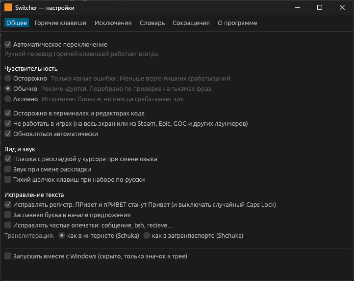
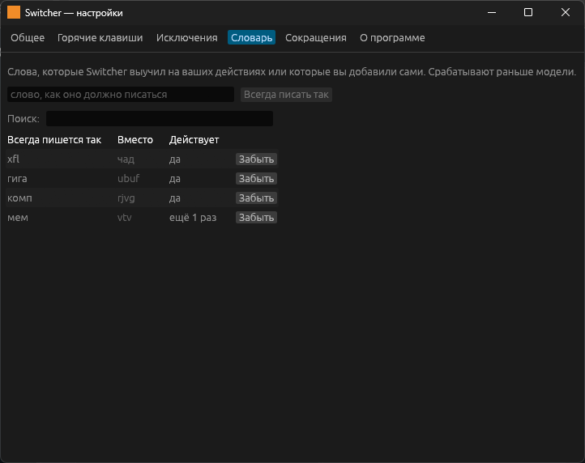
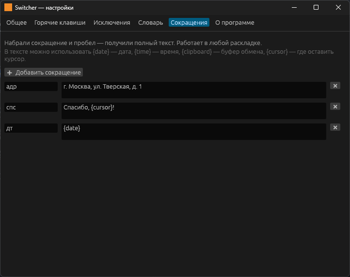

# Switcher

**Автопереключатель раскладки для Windows и Linux** — как Punto Switcher, только точнее.
Набрали `ghbdtn` — получили «привет», набрали `руддщ` — получили `hello`.

<p align="center">
  
</p>

## Чем отличается

- **Языковая модель вместо списков правил.** Решение принимает статистическая модель языка и словари,
  поэтому Switcher узнаёт и слова, которых никто заранее не вписал: фамилии, сленг, новые термины.
  Очевидные случаи исправляет ещё до конца слова.
- **Не трогает технический текст:** команды, пути, адреса, идентификаторы, флаги, код, аббревиатуры.
  В терминалах и редакторах кода работает осторожнее.
- **Не мешает в играх** — сам замечает полноэкранные программы и игры из Steam, Epic, GOG и других
  лаунчеров.
- **Учится на ваших исправлениях** и не трогает то, что вы однажды вернули обратно.
- **Ничего не отправляет и не хранит набранный текст.** В поля пароля не заглядывает. В сеть выходит
  только за обновлениями на GitHub.
- А ещё: ручной перевод слова и выделенного текста, сокращения с подстановкой даты и буфера обмена,
  исправление регистра и Caps Lock, транслитерация, исключения для программ, автообновление.

## Установка

Скачайте `switcher.exe` со страницы [Releases](../../releases) — нужен только он: модели, словари
и окно настроек встроены в этот файл.

1. Положите `switcher.exe` в постоянную папку, например `C:\Programs\Switcher\`.
2. Запустите — появится значок в трее с текущей раскладкой.
3. Правый щелчок по значку → «Запускать вместе с Windows». Программа стартует скрыто,
   только значком в трее. Автозапуск запоминает путь к exe: если переместите файл — включите заново.

Нужны раскладки «Русская» и «Английская» в Windows.

Настройки, выученные слова и сокращения хранятся в `%APPDATA%\Switcher` и переживают обновление.
Если положить `config.toml` рядом с exe, всё будет храниться там (портативный режим).

**Обновления** ставятся сами: раз в несколько часов программа смотрит страницу релизов на GitHub,
скачивает новую версию, сверяет контрольную сумму и ставит её на место старой. Новая версия
заработает при следующем включении компьютера или сама, когда вы минут 10 ничего не печатаете;
в меню значка есть «Перезапустить и обновить». Если папка программы закрыта для записи
(Program Files), обновлённая версия ставится в `%LOCALAPPDATA%\Programs\Switcher`, и автозапуск
переключается на неё. Отключается в настройках.

> В окнах программ, запущенных от имени администратора, Switcher работает, только если и сам
> запущен от администратора — так Windows ограничивает ввод между обычными и повышенными процессами.

## Linux

Работает в Wayland-окружениях **Hyprland** и **KDE Plasma** (в том числе SteamOS в режиме рабочего
стола, Bazzite, CachyOS). Скачайте `switcher-linux-x86_64` со страницы [Releases](../../releases).

Wayland не даёт программам читать чужой ввод, поэтому Switcher забирает клавиатуру себе и пересылает
нажатия через свою виртуальную клавиатуру (как keyd и kmonad). Для этого один раз нужны права:

```
sudo usermod -aG input $USER
echo 'KERNEL=="uinput", GROUP="input", MODE="0660", OPTIONS+="static_node=uinput"' \
  | sudo tee /etc/udev/rules.d/80-switcher-uinput.rules
echo uinput | sudo tee /etc/modules-load.d/uinput.conf
```

и перезайдите в систему. Дальше:

```
install -Dm755 switcher-linux-x86_64 ~/.local/bin/switcher
switcher
```

- **Автозапуск:** в KDE — пункт «Запускать при входе в систему» в меню значка; в Hyprland —
  строка `exec-once = ~/.local/bin/switcher` в `hyprland.conf`.
- **Значок в трее:** в KDE появляется сам, в Hyprland нужна панель с треем (например, waybar с модулем `tray`).
- **Перевод выделенного** берёт текст из primary selection — нужен пакет `wl-clipboard`.
- Настройки и словарь — в `~/.config/switcher`.

Пока не работает в Linux: распознавание полей пароля, профили и исключения программ в KDE,
печать символов, которых нет на клавиатуре (кроме Hyprland с установленным `wtype`), плашка у курсора.
GNOME не поддерживается.

## Использование

| Действие | По умолчанию |
|---|---|
| Перевести последнее (или текущее) слово | `Pause` |
| Перевести выделенный текст | `Shift+Pause` |
| Транслитерировать выделенное | не назначено |
| Включить / выключить автопереключение | двойной щелчок по значку |

Всё остальное — в меню значка в трее и в окне настроек.

<p align="center">
  
  
</p>

**Свой звук переключения:** положите `switch.wav` (или `switch_ru.wav` и `switch_en.wav`) в папку
настроек — он будет играть вместо встроенного.

## Качество

Каждое изменение распознавания проверяется на тысячах реальных фраз из [Tatoeba](https://tatoeba.org)
(независимый от обучающих данных корпус) и на наборе команд и кода — `cargo run --release -p eval`.
Лишних срабатываний и пропусков — меньше 0.1 % слов. Оставшиеся ошибки — в основном настоящая
неоднозначность: `her` ↔ «рук», `it.` ↔ «шею».

## Сборка из исходников

Нужен [Rust](https://rustup.rs) (stable).

```
cargo build --release
```

Результат — `target/release/switcher.exe`.

```
cargo test --workspace                       # тесты
cargo run --release -p eval                  # качество распознавания (нужны корпуса)
cargo run --release -p eval -- --explain ubuf  # почему слово переключилось или нет
bash tools/fetch-corpora.sh                  # скачать корпуса для обучения и проверки
cargo run --release -p trainer               # переобучить модели
```

## Как устроено

```
crates/
├─ layouts/       физическая модель клавиатуры: клавиша → символ в каждой раскладке
├─ langmodel/     символьная языковая модель Kneser-Ney: обучение, формат, запросы
├─ engine/        ядро без WinAPI: буфер слова, защита токенов, решения, обучение, сокращения
├─ platform-win/  Windows: хуки клавиатуры и мыши, SendInput, UI Automation, трей, звуки
├─ platform-linux/ Linux: evdev и uinput, Hyprland и KDE, трей StatusNotifierItem
└─ app/           программа: поток хука, рабочий поток, меню в трее, окно настроек (egui)
tools/
├─ trainer/       строит модели и словари из частотных списков
└─ eval/          проверяет качество на корпусах
```

Низкоуровневый хук только складывает нажатия и за микросекунды решает, пропустить их или нет.
Замена текста, буфер обмена и запись файлов выполняются в отдельном потоке. Нажатия, сделанные
во время замены, придерживаются и досылаются в исходном порядке — ни одна буква не теряется.

## Лицензии

- Код — [MIT](LICENSE).
- Языковые модели и словари (`crates/engine/data/*.lm`, `*.fst`) построены по частотным спискам
  [FrequencyWords](https://github.com/hermitdave/FrequencyWords) (OpenSubtitles 2018) и
  распространяются на условиях [CC BY-SA 4.0](https://creativecommons.org/licenses/by-sa/4.0/).
- Для проверки качества используются предложения [Tatoeba](https://tatoeba.org)
  ([CC BY 2.0 FR](https://creativecommons.org/licenses/by/2.0/fr/)); в программу они не входят.
